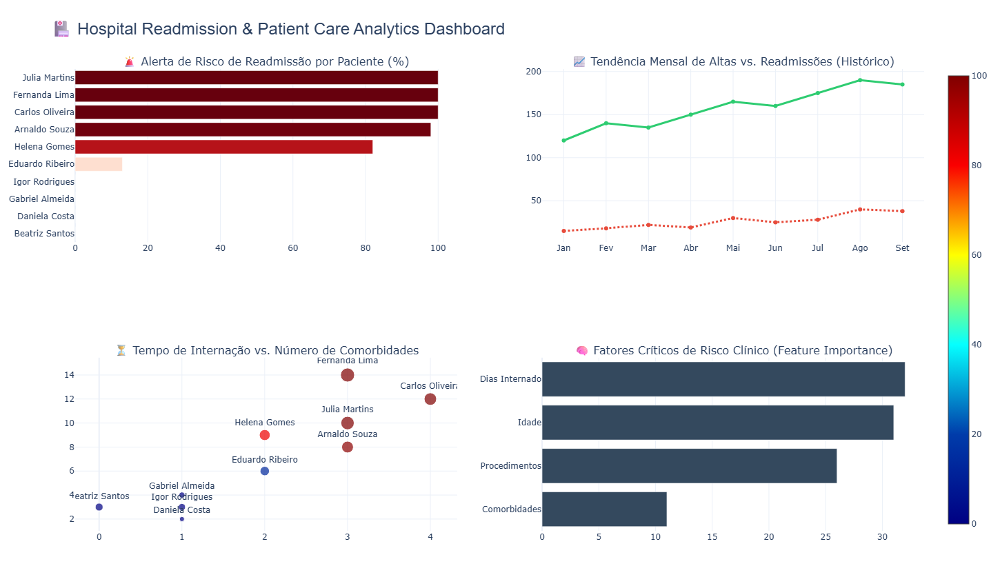

# 🏥 Hospital Readmission & Patient Care Analytics

Este repositório contém um sistema de análise preditiva clínica e inteligência hospitalar voltado para a **previsão de risco de readmissão de pacientes em menos de 30 dias após a alta**.

---

## 📊 Cockpit de Inteligência Hospitalar (Clinical BI)

Observe abaixo o painel interativo de monitoramento integrado gerado pelo pipeline:

---

## 🔬 Engenharia e Modelagem de Saúde
* **Algoritmo Preditivo**: Treinamento do modelo **Random Forest Classifier** para calcular o score de risco clínico individual dos pacientes com base em comorbidades, idade e tempo de internação.
* **Feature Importance**: O modelo de Inteligência Artificial isolou a variável **Dias Internado** como o indicador de maior peso crítico para a readmissão, fornecendo insumos estatísticos para a equipe de auditoria médica.
* **Análise de Tendência Temporal**: Monitoramento histórico integrado comparando o volume de altas gerais com os picos de reinfecção e readmissão a curto prazo.
